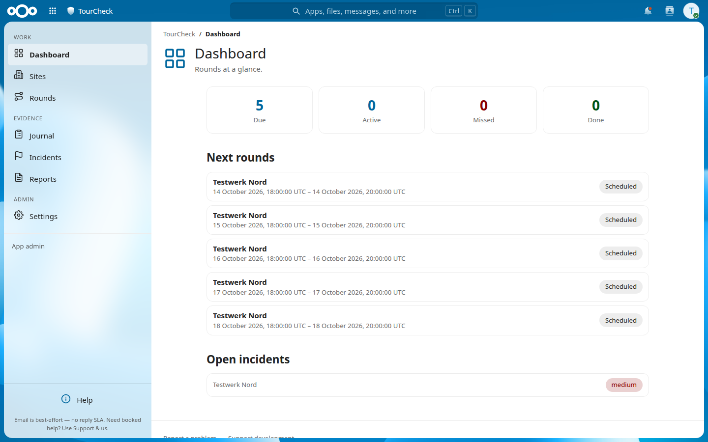
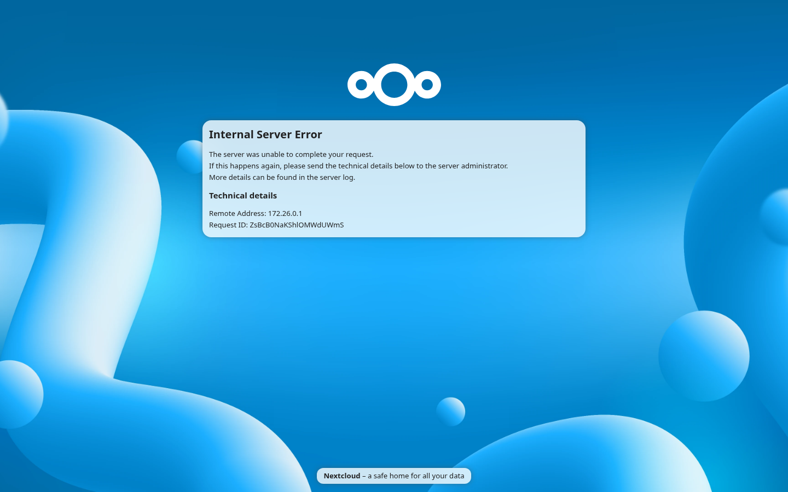
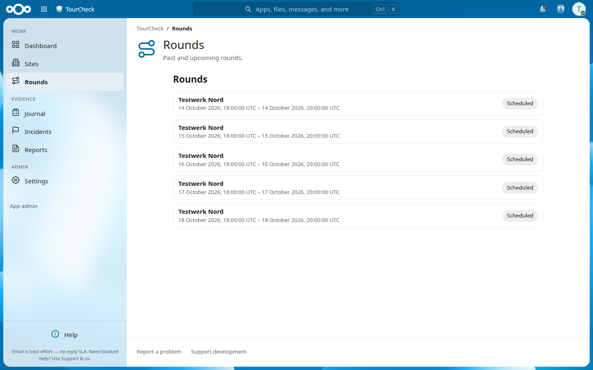
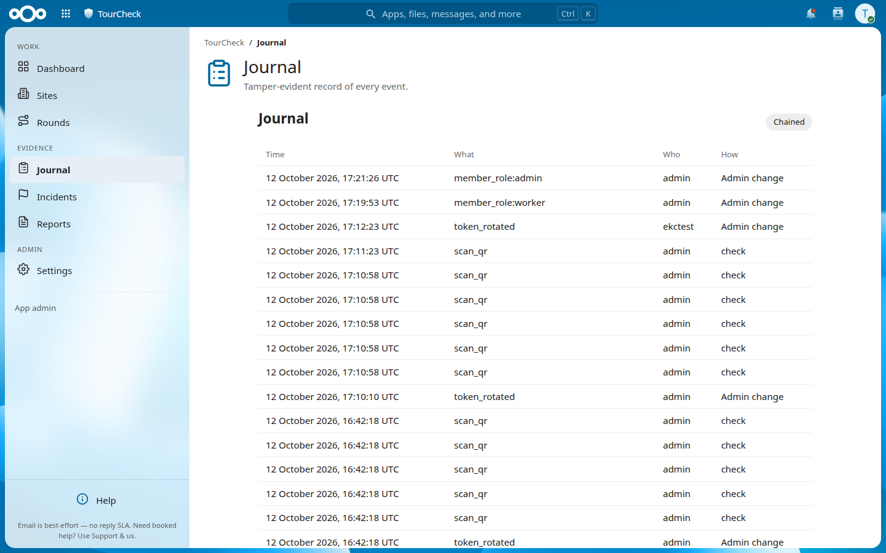
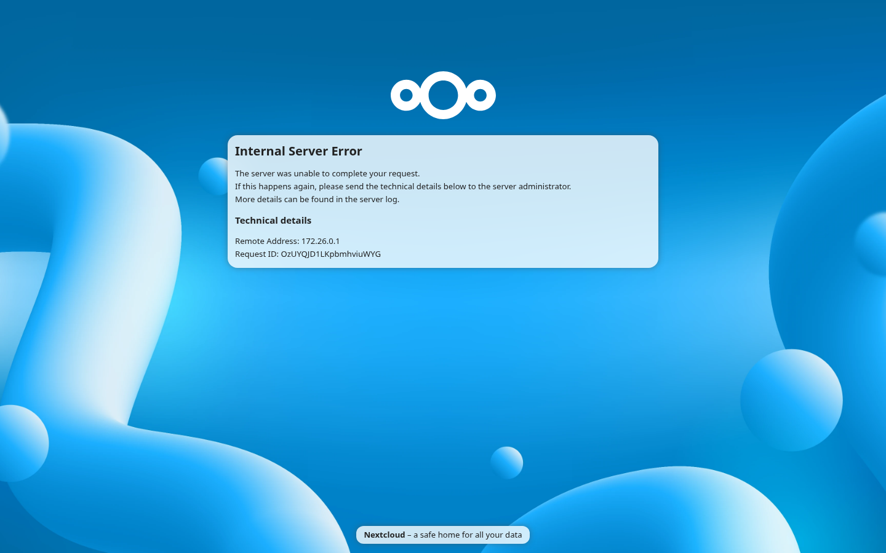

# TourCheck (Rounds & Checkpoint Documentation) for Nextcloud

App ID in Nextcloud: **`tourcheck`**. Clone path:

```bash
git clone https://github.com/aSoftwareByDesignRepository/nextcloud-tourcheck.git /path/to/nextcloud/apps/tourcheck
```

---

Document security patrols, facility rounds, and inspections on your own
Nextcloud — with evidence that holds up when a customer, insurer, or auditor
asks *"prove it"*.

## Overview

TourCheck is a complete patrol-and-inspection documentation system for
Nextcloud. Planners define sites and checkpoint rounds; workers confirm
checkpoints by scanning QR/NFC tokens or signing off at shared kiosk
stations; supervisors attest, investigate incidents, and export
evidence-grade reports. Every event lands in an append-only, hash-chained
journal (Wachbuch) that can be cryptographically verified — and optionally
anchored externally via RFC 3161 timestamps.

It works out of the box with no external service dependencies.

## Features

### Core functionality
- **Sites & checkpoints**: QR code sheets (`tckt://`) and signed NFC tags
  (`tcks://`), per-site timezone, address, and briefing notes
- **Round planning**: scheduled windows with RRULE recurrence, grace
  periods, missed-round detection, and supervisor alerts
- **Worker companion capture**: scan-to-confirm via the TourCheck mobile
  companion (Android/iOS), offline queue with automatic retry
- **Kiosk stations**: shared device sign-off with per-member PINs, atomic
  lockout policy, and optional signature capture
- **Incidents**: structured incident reports with photos, voice notes,
  threshold breaches, severity levels, and corrective tracking
- **Append-only journal**: per-site hash-chained event log; CLI and UI
  verification (`occ tourcheck:verify-chain`); tamper-evident tombstones
- **External anchoring**: optional RFC 3161 timestamp authority (TSA)
  anchoring of journal heads
- **Reports**: evidence-grade PDF/CSV/ODS exports, scheduled report
  emails, and claim bundles for disputes
- **Live status links**: revocable, expiring public read-only links for
  customers (no login required, `noindex`)
- **Key register**: track physical key hand-outs and returns with a
  CAS-guarded ledger
- **Privacy by design**: optional per-site live-position tracking —
  disclosed, opt-in, visible while active, auto-purged; GDPR erasure and
  retention purge built in

### User interface
- **Responsive**: desktop, tablet, and mobile layouts
- **Accessible**: WCAG 2.1 AA — keyboard navigation, high contrast,
  forced-colors and reduced-motion support
- **Multi-language**: 12 locales (en, de, da, es, fr, it, nb, nl, pl,
  pt-BR, sv + more via Nextcloud l10n)
- **Dark mode**: follows the Nextcloud theme, including custom accents

### Mobile companion (TourCheck Mobile)
- **Worker mode**: today's rounds, scan confirm, incident capture,
  offline-first queue, optional disclosed live position
- **Station mode**: kiosk PIN sign-off for shared devices
- Licensed per named seat / station device (`TCK2`) — the web app is never
  gated by the device licence

## Installation

### Requirements
- Nextcloud 32 or higher
- PHP 8.2 or higher
- MySQL/MariaDB or PostgreSQL

### Installation steps
1. Download the app files to your Nextcloud `apps` directory
2. Enable the app in Nextcloud admin settings (migrations run automatically)
3. Create a site, add checkpoints, print the QR sheet
4. Grant users the `tourcheck_*` groups as needed (admin, planner,
   supervisor, worker)
5. Apply a `TCK2` licence under Admin → TourCheck → Licence when using the
   mobile companion or kiosk stations

## Configuration

### Admin settings
- **Licence**: apply and inspect the `TCK2` companion licence
- **Access**: restrict the app to specific users/groups
- **Evidence**: journal anchoring (TSA endpoint, CA bundle), signature and
  photo policy
- **Retention**: journal and position retention periods, GDPR erasure
- **Stations**: enroll kiosk devices, bind checkpoints, PIN policy
- **Reports**: scheduled report recipients and formats

### User preferences
- Language, theme (light/dark/high contrast via Nextcloud theming)

## Security

- **Uniform 404 boundary**: "not found" and "not yours" collapse into one
  canonical payload — no existence oracles on any ID-bearing route
- **Role-based access**: NC groups plus per-site membership
  (admin/planner/supervisor/worker); kiosk stations use scoped bearer
  tokens with rate limiting and lockout
- **Idempotent ingest**: `client_event_id` dedupe survives retries and
  true concurrency
- **Optimistic locking**: fail-closed CAS on revisions — stale writes get
  409, never silent last-writer-wins
- **Chain integrity**: journal appends under a named lock with a unique
  `(site_id, seq)` backstop
- See [SECURITY.md](SECURITY.md) for reporting a vulnerability

## Screenshots

| Dashboard | Sites | Site detail |
| --- | --- | --- |
|  |  |  |

| Rounds | Journal | Reports |
| --- | --- | --- |
|  |  |  |

## Publishing to the Nextcloud App Store

1. **Requirements**: `LICENSE` (AGPL-3.0), `CHANGELOG.md`, and `README.md`
   up to date; `appinfo/info.xml` with valid `bugs`, `repository`, and
   `author` entries.
2. **Version**: bump `appinfo/info.xml` and add a `CHANGELOG.md` entry.
3. **Package**: `make release` builds `build/release/tourcheck.tar.gz`
   (development files excluded).
4. **Signing**: `make sign` — sign with `occ integrity:sign-app` using your
   private key and certificate. Submit a CSR to Nextcloud for an official
   certificate when publishing.
5. **Submit**: upload the signed archive at
   [apps.nextcloud.com](https://apps.nextcloud.com).

## Support

- **Issues**: https://github.com/aSoftwareByDesignRepository/nextcloud-tourcheck/issues
- **Website**: https://nextcloud.software-by-design.de/
- **Sponsorship**: https://github.com/sponsors/aSoftwareByDesignRepository

## Acknowledgments

- **Nextcloud GmbH** — for the excellent Nextcloud platform
- **Nextcloud community** — for feedback, testing, and translations
- **Contributors** — everyone who contributed code, audits, and ideas

---

**Copyright © 2026 Alexander Mäule / Software by Design GbR**
**Licensed under AGPL-3.0-or-later**
